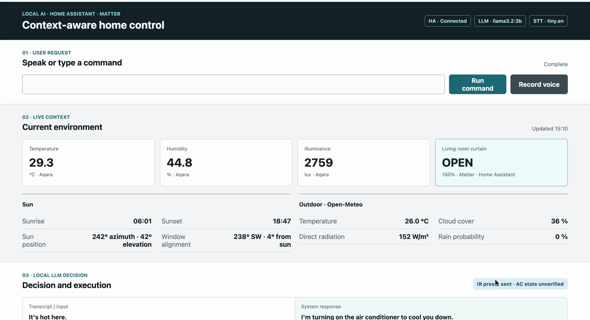

# Context-Aware Local LLM-Based IoT Control System

**English**

- **What:** An English voice/text smart-home controller for variety of IoT devices.
- **How:** Local speech recognition and LLM inference combine with sensor context, deterministic policies, and command validation before Home Assistant execution.
- **Why:** To examine how post-processing changes command correctness when a small local LLM connects natural-language requests to deployed devices.

**한국어**

- **무엇을:** 영어 음성 또는 텍스트로 IoT기기들을 제어하는 스마트홈 시스템을 만들었다.
- **어떻게:** 로컬에서 음성을 텍스트로 변환하고, 센서 맥락을 받은 LLM의 출력을 결정론적 정책과 명령 검증을 거쳐 Home Assistant로 실행한다.
- **왜:** 소형 로컬 LLM의 자연어 해석을 실제 장치 제어에 연결할 때 후처리가 명령 정확성에 어떤 영향을 주는지 확인하기 위해 만들었다.

## KICS 2026 Paper

**센서 맥락 기반 정책과 명령 검증을 결합한 로컬 LLM 기반 IoT 제어 시스템의 구현 및 평가**

*Implementation and Evaluation of a Local LLM-Based IoT Control System with Sensor-Context-Based Policy and Command Validation*

**김석현 / Seokhyeon Kim**, Yeungnam University.

**[Read the Korean paper (PDF)](docs/papers/KICS_2026_Undergraduate_Seokhyeon_Kim.pdf)** | [Paper details](docs/papers/README.md) | [Evaluation and reproduction](docs/experiments/kics_2026/README.md)

This is the author's submission manuscript for KICS 2026 Fall, not a
publisher-issued proceedings copy. No acceptance or award status is asserted here.
The PDF is unchanged from the supplied submission file.

## Release Scope

This public release packages the **KICS reference implementation and evidence**.
Its source snapshot is `0cdca36e0cdd408c9998fbdfa58e00ede841a784` from the private
development repository, rather than the latest experimental development version.
Later parser revisions and unfinished follow-up studies are not included.
See [release provenance and public-data boundaries](docs/public-release.md).

The initial public commit `4e16ebc` remains available. It is an earlier MVP, not
the implementation used for all quantitative results below.

## System

```text
English voice or text
        -> faster-whisper STT (voice only)
        -> request + Home Assistant sensor/curtain context
        -> Ollama llama3.2:3b
        -> normalization / state policy / device-action allow-list / schema validation
        -> Home Assistant
        -> Matter / Aqara Hub M3
        -> Zigbee curtain or IR air conditioner
```

Core speech recognition, LLM inference, context processing, and control run locally.
Optional Open-Meteo weather information uses an external API; this is not a claim
that every feature is independent of external services. Home Assistant state is
also supplied directly to the state policy. Local solar and optional cached
weather information supplement the application context.

The system was developed and demonstrated on a MacBook Air M1 with 8 GB RAM.
A simulation backend supports development without the Home Assistant VM or devices.




## Measured Results

Command exact match compares the order-independent multiset of
`(entity_id, action, value)`, preserving duplicate counts.

| Condition | Requirements-based, 40 cases | Prospective expressions, 20 cases |
| --- | ---: | ---: |
| LLM Only | 8/40 (20.0%) | 6/20 (30.0%) |
| LLM + Context | 8/40 (20.0%) | 5/20 (25.0%) |
| Rules Only | 31/40 (77.5%) | 10/20 (50.0%) |
| **Full Pipeline** | **37/40 (92.5%)** | **13/20 (65.0%)** |

- Five complete repeats preserved the 40-case Full Pipeline score and the same
  case-level outcomes. These are repeated inputs, not 200 independent test cases.
- The prospective set was authored by the developer and frozen before its first
  evaluation. It is not an independent external benchmark.
- Original one-speaker recordings: WER **22/216 (10.2%)** and audio-to-gold command
  match **30/36 (83.3%)**.
- Separately collected three-speaker recordings: WER **91/648 (14.0%)** and
  audio-to-gold command match **82/108 (75.9%)**. Devices and rooms were not controlled.
- Warm software command planning: **3.22 s mean** over 30 measured calls after six
  warm-up calls. This excludes STT, Home Assistant context retrieval, control calls,
  and physical motion.
- Curtain trials: final Home Assistant state matched the expected state **6/6**,
  with the opposite initial state checked before each trial. This is a small
  functional check, not a reliability estimate.
- IR AC reactions were observed for fixed Cool 24 and Off presets. The system has
  no authoritative AC power, mode, or temperature feedback.

The [post-hoc component analysis](docs/experiments/kics_2026/component-ablation-posthoc-2026-10-02.ko.md)
replays preserved LLM outputs without new inference. Removing normalization gave
23/40 and 12/20 matches; removing the device/action allow-list gave 30/40 and 7/20.
It does not establish independent causal contributions or physical safety.

These results describe different workloads and must not be merged into a single
accuracy or end-to-end latency claim. See the
[complete results index](docs/experiments/kics_2026/README.md).

## Setup and Simulation

Python 3.10 or newer is required by the source syntax. The release checks document
the actual Windows test environment; the historical measurements used macOS.

### macOS / Linux

```bash
python3 -m venv .venv
source .venv/bin/activate
pip install -r requirements.txt
cp .env.example .env
```

For local LLM inference, install Ollama separately and download the model:

```bash
ollama pull llama3.2:3b
./scripts/run.sh simulation
```

### Windows PowerShell

```powershell
py -3 -m venv .venv
.\.venv\Scripts\python.exe -m pip install -r requirements.txt
$env:CONTROL_BACKEND = "simulation"
.\.venv\Scripts\python.exe -m uvicorn app.main:app --host 127.0.0.1 --port 8000
```

Open `http://127.0.0.1:8000`. Simulation is the default. If Ollama is unavailable,
the application can use a deterministic fallback parser; that is not successful
LLM inference and must not be reported as an LLM evaluation result.

The Bash launcher loads `.env`. Direct Windows startup does not load `.env`
automatically; set the required process environment variables explicitly.

## Physical Mode and Boundaries

Configure your own Home Assistant URL and token privately, plus the deployed
entities. Never commit credentials, exact home coordinates, or pairing information.

```text
CONTROL_BACKEND=home_assistant
HOME_ASSISTANT_URL=<your-local-home-assistant-url>
HOME_ASSISTANT_TOKEN=<your-private-token>
HOME_ASSISTANT_AC_COOL_ENTITY=<your-cool-scene-entity>
HOME_ASSISTANT_AC_OFF_ENTITY=<your-off-scene-entity>
```

The demonstrated mappings are a curtain cover and two bounded AC scene presets:

```text
cover.living_room_curtain -> your Aqara curtain cover entity
climate.air_conditioner  -> your AC Off and AC Cool 24 scene switches
```

The physical adapter rejects unmapped virtual devices. The allow-list limits
device/action scope, but it does not prove that every request is interpreted
correctly. This is a research/demo controller, not a safety-critical system.
Keep the server on a trusted local interface; it is not a hardened public service.

No new hardware, microphone, LLM-performance, or latency measurement was performed
as part of this public packaging task.

## Tests and Reproduction

```bash
python -m unittest discover -s tests -v
python docs/experiments/kics_2026/validate_cases.py
python docs/experiments/kics_2026/validate_stt_cases.py
```

Unit tests use mocks and synthetic fixtures. They do not reproduce the published
accuracy figures. Fresh LLM evaluation requires Ollama and a compatible model;
speech evaluation requires recordings that are not distributed here. The fixed-output
component analysis also requires private raw JSONL. Public hashes support integrity
checks but cannot replace those missing files.

## Documentation

- [Documentation map](docs/README.md)
- [KICS paper](docs/papers/README.md)
- [Evaluation protocol, datasets, and result summaries](docs/experiments/kics_2026/README.md)
- [Release provenance and exclusions](docs/public-release.md)
- [System overview](docs/architecture/system_overview.md)
- [Earlier MVP report](docs/reports/2026-09-06-mvp-final-report.ko.md)
- [Demo media catalog](docs/media/demo-evidence.md)

The code and documents do not include a repository-wide license grant in this
release. Third-party software and model licenses remain separate. The paper is
provided as the author's manuscript; no publisher-issued license is asserted.
