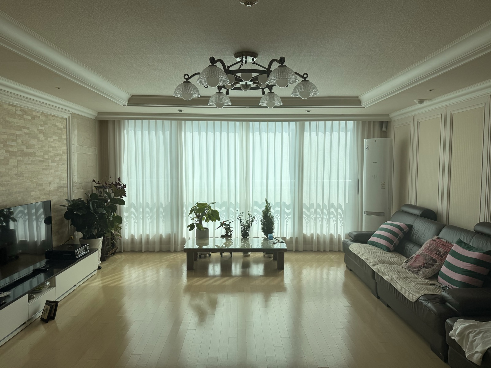

# Local LLM Smart Home MVP 최종 보고서

## 1. 개발 목적

영어 음성 또는 텍스트 명령을 로컬에서 처리하고, 실내외 환경 정보를 함께 고려해 실제 스마트홈 장치를 제어하는 시스템을 구현했다. 클라우드 LLM에 의존하지 않고 MacBook에서 STT와 LLM을 실행하는 것을 기본 조건으로 삼았다.

## 2. 개발 환경

- 실행 장치: MacBook Air M1, 8 GB RAM, 256 GB 저장장치
- STT: faster-whisper `tiny.en`
- LLM: Ollama `llama3.2:3b`
- API 및 웹: FastAPI, HTML, CSS, JavaScript
- 장치 허브: Home Assistant OS 18.2, UTM 4.7.5 ARM64 VM
- 스마트홈 연결: Aqara Hub M3 Matter Bridge
- 실제 장치: Aqara 커튼 컨트롤러, 온습도 센서 T1, 조도 센서 T1, M3 IR 에어컨 컨트롤러
- 외부 정보: Open-Meteo, Astral 기반 일출·일몰 및 태양 위치 계산

## 3. 구현 구조

```text
음성 또는 텍스트
-> faster-whisper STT
-> Home Assistant 실내 상태 조회
-> 태양 및 외부 날씨 Context 결합
-> local llama3.2:3b
-> 명령 정규화 및 정책 검증
-> 허용된 실제 장치만 실행
-> Home Assistant
-> Matter / Aqara Hub M3
-> 커튼 및 IR 에어컨
```

LLM 출력은 바로 실행하지 않는다. JSON 스키마 검증, 문장 정규화, 현재 상태에 따른 중복 명령 제거, 물리 장치 allow-list를 통과한 명령만 Home Assistant에 전달한다.

## 4. 주요 구현 내용

- 브라우저 마이크 녹음과 영어 STT 변환
- 사용자 문장과 현재 Home Context를 포함한 로컬 LLM 입력 구성
- 온도, 습도, 조도, 커튼 위치의 request-time snapshot
- 일출, 일몰, 태양 방위각·고도 및 거실 창 방향 관계 계산
- 외부 온도, 체감온도, 강수확률, 운량, 풍속, 일사량 캐시
- 커튼의 열기, 닫기, 정지 명령 매핑
- Aqara Scene Sync를 통한 `AC Off` 및 `AC Cool 24` IR 명령
- 이미 만족된 커튼 명령과 센서 조건이 충족되지 않은 상황 명령의 no-op 처리
- 실제 장치 없이 개발할 수 있는 simulation backend 유지 및 API 통합 테스트

## 5. 최종 검증 결과



현장 촬영에서 다음 전체 경로를 사용자 육안으로 확인했다.

```text
브라우저 마이크
-> STT
-> 실제 실내외 Context
-> 로컬 LLM 및 정책 계층
-> Home Assistant
-> Aqara M3
-> 실제 커튼 닫힘 및 에어컨 Cool 24 동작
```

에어컨 종료 명령도 실제 동작했다. `AC Off`를 두 차례 실행한 뒤 다시 `AC On`을 실행한 반복 시험에서도 정상 동작을 확인했다.

현장 자료로 거실 전경, 커튼 레일에 설치된 컨트롤러 2대, 노트북 대시보드와 실제 커튼을 함께 촬영한 영상 2개를 보존했다. 공개용 JPEG에서는 원본 사진의 위치 메타데이터를 제거했다.

2026-09-06 오프라인 개발 단계에서는 Home Assistant와 실제 장치를 사용하지 않고 simulation API 통합 테스트를 추가했다. 전체 24개 자동화 테스트가 통과했다. Ollama와 Home Assistant가 중지된 상태에서도 simulation 서버의 영화 모드 명령이 fallback parser를 통해 정상 적용되는 것을 HTTP 요청으로 확인했다.

## 6. 제한 사항

- IR 에어컨은 명령 전송만 가능하며 실제 전원, 운전 모드, 설정 온도를 Home Assistant가 확정할 수 없다.
- 모션 센서와 SONOFF/ZHA 장치는 완료된 MVP 범위에서 제외했다.
- Open-Meteo 장애 시 외부 Context는 사용할 수 없지만 로컬 장치 제어는 계속 가능하다.
- 자동 이벤트 기반 제어와 상시 원격 접속은 구현하지 않았다.

## 7. 결론

MacBook Air M1 한 대에서 음성 인식, 로컬 LLM 추론, 환경 Context 수집, 정책 검증, Home Assistant 연동을 실행하고 실제 Zigbee 커튼과 IR 에어컨을 제어했다. simulation backend도 유지해 현장 장치 없이 명령 처리와 상태 변화를 계속 개발하고 검증할 수 있도록 했다.
